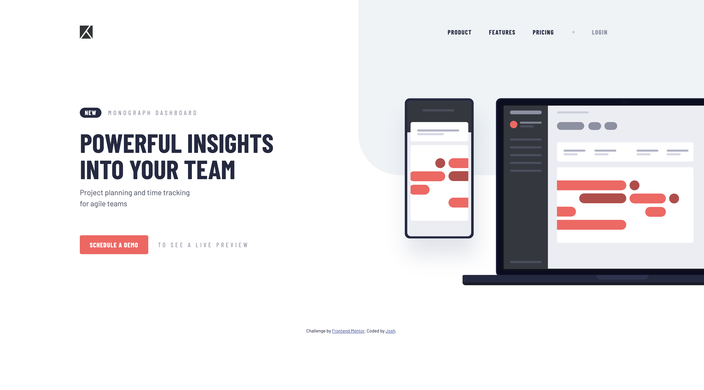

# Frontend Mentor - Project tracking intro component solution

This is a solution to the [Project tracking intro component challenge on Frontend Mentor](https://www.frontendmentor.io/challenges/project-tracking-intro-component-5d289097500fcb331a67d80e).

## Table of contents

- [Overview](#overview)
  - [The challenge](#the-challenge)
  - [Screenshot](#screenshot)
  - [Links](#links)
- [My process](#my-process)
  - [Built with](#built-with)
  - [What I learned](#what-i-learned)
  - [AI Collaboration](#ai-collaboration)
- [Author](#author)

## Overview

### The challenge

Users should be able to:

- View the optimal layout for the site depending on their device's screen size
- See hover states for all interactive elements on the page
- Create the background shape using code

### Screenshot



### Links

- Solution URL: [Add solution URL here](https://your-solution-url.com)
- Live Site URL: [Add live site URL here](https://your-live-site-url.com)

## My process

### Built with

- Semantic HTML5 markup
- CSS custom properties
- Flexbox
- Mobile-first workflow
- Vanilla JavaScript

### What I learned

This was a small project, but the mobile menu taught me a few habits I'll keep using.

**One function to own the menu state.** Every way of opening or closing the menu (button, outside click, Escape, link click, resize) goes through `setOpen()`. The class, `aria-expanded` and `aria-label` can never get out of sync.

```js
function setOpen(isOpen) {
  header.classList.toggle("is-open", isOpen);
  navToggle.setAttribute("aria-expanded", isOpen);
  navToggle.setAttribute("aria-label", isOpen ? "Close menu" : "Open menu");
}
```

**Let CSS react to state.** JS only changes a class and an ARIA attribute. CSS decides what's visible, including swapping the hamburger and close icons:

```css
.nav-toggle[aria-expanded="true"] .icon-open {
  display: none;
}
.nav-toggle[aria-expanded="true"] .icon-close {
  display: block;
}
```

**Closing on outside click.** `header.contains(e.target)` checks whether a click happened inside the header. Checking the header instead of just the menu matters: the toggle button's click bubbles up to `document`, and would otherwise close the menu right after opening it.

**Operator precedence bug.** I first wrote `if (!e.key === "Escape")`. `!` runs before `===`, so this compares `false` to `"Escape"` and is never true, which meant every key closed the menu. The fix is `e.key !== "Escape"`.

**Small accessibility details.** After closing with Escape, focus returns to the toggle button so keyboard users don't lose their place.

**Resetting on breakpoint change.** `matchMedia("(min-width: 60em)")` fires a `change` event when the window crosses the desktop breakpoint, so the menu doesn't reappear open when resizing back down.

**Clipping overflowing images on mobile.** `overflow-x: hidden` on `body` wasn't enough: mobile browsers widened the layout viewport and zoomed the whole page out. Using `overflow-x: clip` on the section that contains the oversized illustration fixed it.

### AI Collaboration

Using Claude Code:

- Build up the HTML skeleton
- Debugging

## Author

- Website - [Josh Liu](https://my-portfolio-frontend-kappa-lemon.vercel.app/)
- Frontend Mentor - [@JoshLiu111](https://www.frontendmentor.io/profile/JoshLiu111)
